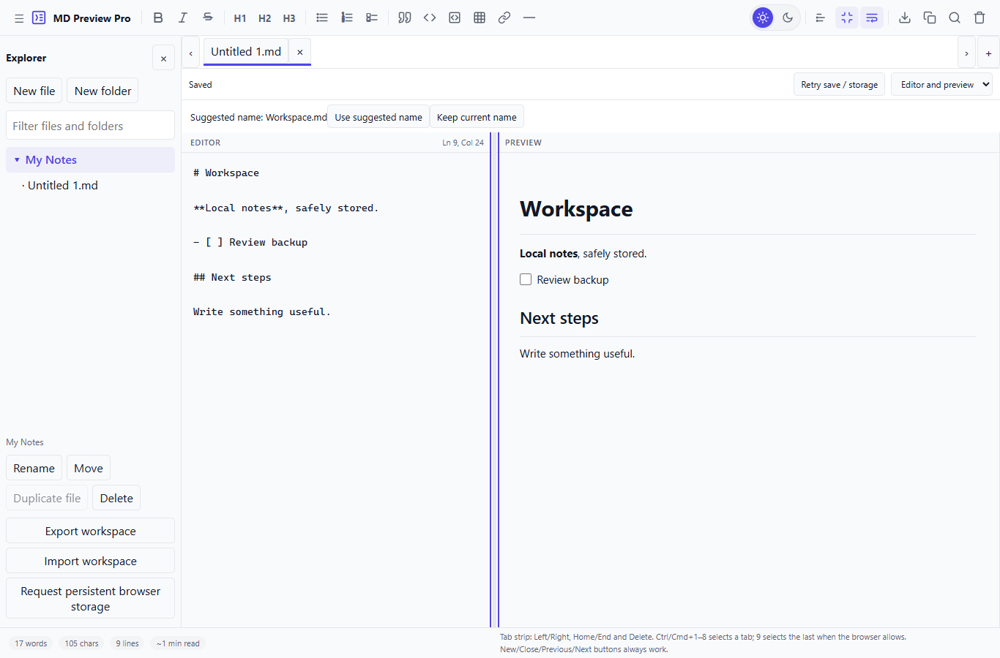

# MD Preview Pro

Built with **HTML and strict TypeScript**. A local-first Markdown workspace with nested folders, browser-style document tabs, live preview,
formatting tools and workspace backups. No account, cloud API, telemetry, AI or backend database.

Version **1.0.0**, browser application. Node **22.13+** serves the app on Windows, macOS or Linux;
current browser evidence is Windows/Edge. There is no native installer or published download pipeline.

Existing demo: [MD Preview Pro](https://markdown-preview-pro.vercel.app) (previous published version;
this workspace branch has not been deployed).

## Run

    npm ci
    npm run build
    npm start

Open **http://127.0.0.1:4175**. PORT selects another loopback port. Keep the same scheme, hostname,
port and browser profile to reopen your workspace. No .env file is read. Serve over HTTP using the
included exact-allowlist server. Opening index.html directly is unsupported; assets compile into dist/.

## Workspace

- A fresh browser origin gets My Notes and one blank Untitled 1.md. Reloads reuse them.
- Explorer creates nested folders/files, filters names, and renames, moves, duplicates or deletes items.
  Select a folder before New file. The tab-strip + uses the selected folder or active file’s folder.
- Click a file to open/activate its existing tab. Tabs from all folders share one horizontally scrolling
  strip. Closing a tab keeps its file; deleting a folder confirms deletion of its entire subtree.
- Names are case-insensitive within a folder and item kind. Files normalize to .md; invalid path/device
  names are rejected. IDs survive rename/move. Duplicate uses a new ID and a numbered collision suffix.
- A heading or meaningful text produces an offline suggested filename. Use it, keep the current name,
  or revert an accepted suggestion during the current session. Manual choices are never overwritten.
- Each tab retains edits, selection and scroll while switching. Tabs/order, selected/expanded folders,
  theme, Explorer visibility, wrap, sync, outline, layout and desktop split width survive reloads.
  On narrow screens Explorer starts closed and opens as a drawer. Undo history is not restored.
- Every active document has the existing formatting toolbar, search, outline, task toggles, statistics,
  Markdown download and sanitized HTML copy. Code labels are displayed; syntax highlighting is not included.

## Saving, conflicts and recovery

IndexedDB v1 stores files/folders. Edits autosave after 300 ms; visibility changes, tab closing and
page lifecycle events also request saves. **Saved** means the transaction completed. **Save failed**
keeps the draft in the window and blocks closing its tab; use Retry or Export workspace. A sudden
browser/OS crash can lose edits that have not committed. Do not close a window containing failed saves.

Same-origin windows refresh through BroadcastChannel, plus IndexedDB checks on focus and every two
seconds while visible. Concurrent changes cause **Conflict**; keep local as a separate recovered file,
or confirm reloading the stored version. Neither option silently overwrites the other window’s file.

On upgrade, md-preview-pro-content migrates exactly once, including empty strings and oversized content.
The legacy key remains untouched; md-preview-theme remains supported. Oversized content remains stored
and exportable, while parsing/saving is blocked until within the original per-document limits:
**200,000 characters, 10,000 lines, 10,000 characters per line**. Workspace limits are **10,000 total
files/folders** and **64 folder levels**. Large-workspace performance has not been benchmarked.

**Export workspace** downloads versioned JSON, including separate copies of unsaved drafts when needed.
**Import workspace** validates UTF-8/JSON, records, names, references, cycles and limits, then previews
counts and asks for Merge (new IDs) or destructive Replace. Replacement is atomic and refuses a stale
workspace. Imports count actual streamed bytes before retention and are limited to **32 MiB**. Exceptionally large legacy exports may exceed that import
limit; the UI warns you. Keep those originals and export individual Markdown files before clearing data.
If corrupted storage cannot be validated, raw recovery JSON can require manual inspection rather than
normal import. No ZIP export or individual Markdown import is included.

Browser data is not a permanent backup. Clearing site data, changing profile/origin/device, or ending an
incognito session can remove or isolate files. There is no cross-device or native filesystem sync.
Request persistent browser storage is an explicit, optional action; it cannot prevent manual deletion.
Export backups regularly. Local browser data is unencrypted and accessible to other profile users.

## Keyboard and accessibility

- Ctrl/Cmd+B and I format; S downloads Markdown; F searches the active document.
- In the tab strip: Left/Right, Home/End activate tabs; Delete closes a tab. Previous/Next/New/Close
  buttons provide alternatives. Explorer uses Up/Down, Left/Right, Home/End and Enter/Space.
- Ctrl/Cmd+1–8 selects positions 1–8; 9 selects the last. Ctrl/Cmd+Tab/Shift+Tab, N and W are handled
  only when the browser delivers cancelable events. Browsers often reserve these combinations for
  browser tabs/windows. They cannot be guaranteed. Ctrl/Cmd+0 retains browser zoom reset.
- Tab in the editor inserts two spaces. **Escape, then Tab**, or Shift+Tab, leaves the editor.
  Escape closes search and the mobile Explorer. Dialogs restore focus and support Escape to cancel.
- Choose Editor only / Preview only / Editor and preview. The desktop splitter accepts arrow keys and
  Home; reduced motion is respected. The mobile editor/preview stack vertically.

[Mobile screenshot](docs/assets/workspace-mobile.png). Automated scans and keyboard/reflow checks are
scoped evidence; full WCAG certification, assistive-technology and physical-device testing are unverified.

## Privacy and security

The preserved flow is bounded parser → DOMPurify → detached safe DOM → preview. HTML copy uses the same
sanitizer. Scripts, unsafe URLs, active markup and clobbering names/IDs are excluded. External images get
no src until an explicit per-image Load remote image action. This sends the image URL and IP address to
its host. Following links contacts their hosts; no referrer is sent. No remote runtime code/fonts load.

All authored interface copy lives in public/markdown-preview-pro.model.json. Build validates it and
bundles a generated local copy; runtime does not fetch translations. English ships today. The adapter
checks locale parity/placeholders and falls back to English for unsupported device locales.

## Verify and CI

    npm run build
    npm run verify
    npm run typecheck
    npm run scan:secrets
    npm run e2e
    npm audit --audit-level=moderate

Browser tests default to installed Edge. For installed Playwright Chromium, set E2E_CHANNEL=chromium.
CI installs Chromium. TypeScript 7.0.2 compiles application, tooling and test source into ignored dist/.
Builds also prepare the locked DOMPurify runtime/license and generated content data. Browser JavaScript
is compiler output; DOMPurify is the only JavaScript vendor asset. React/Next.js are unnecessary for the
current local-only workflow.

| Event | Behavior |
|---|---|
| Local verify | Strict TypeScript, build, compiled syntax/content checks, Node tests |
| Push / pull request | Frozen install, verify, audit and Chromium browser tests |
| Deployment / release | Not configured; no publish authorization |

Dated phase gates, final command evidence and limitations are in [the architecture guide](docs/ARCHITECTURE.md).
Local verification on 2026-11-17 passed strict TypeScript, 23 Node tests, 18 Edge browser tests
and the dependency audit (zero findings). Hosted results are separate from local results. SAST,
combined browser/Node coverage and field performance remain gaps; the measured unit subset is below
inherited 90% coverage targets.

## Source

    src/app.ts                 editor state/composition
    src/editor/                preserved workflows and active-document bridge
    src/workspace/             database, migration, repository, Explorer, tabs, sync, backup
    src/parser.ts              existing bounded Markdown parser
    src/security.ts            sanitizer, URL policy and document limits
    src/contracts.d.ts         typed entity, repository and UI contracts
    tsconfig.json              strict compilation to ignored dist/
    public/                    authoritative content model
    tools/                     allowlist server, build/content/check tooling
    tests/ and e2e/            Node and real-browser regression tests
    docs/                      architecture and inspected synthetic screenshots

The manifest declares MIT. DOMPurify retains its upstream Apache-2.0/MPL-2.0 terms in
[the bundled license](vendor/DOMPurify-LICENSE). Fonts use local system fallbacks. Development dependencies
include TypeScript, Playwright, jsdom, fake-indexeddb and axe-core; they are not served to application users.

The review branch feature/local-first-workspace-typescript opts out of Vercel automatic deployment
in vercel.json. Publishing the workspace or changing hosting configuration requires separate approval.

Repository AGENTS.md uses the supplied v2.6.0 standard; .codex/config.toml raises only the project
instruction budget. The architecture guide records the applicable controls and remaining QA gaps.
