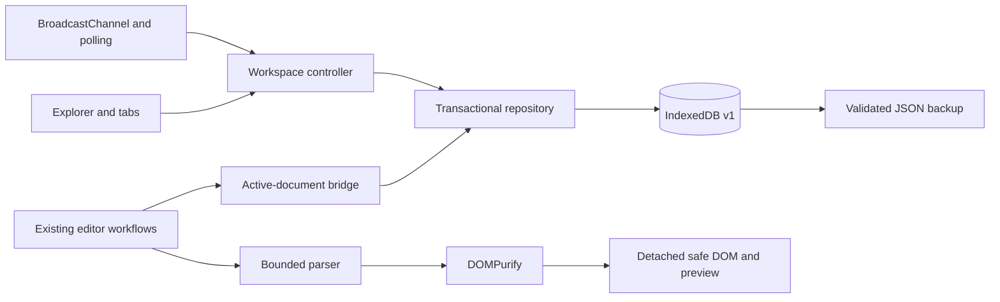

# MD Preview Pro architecture

## Contents

1. Scope and boundaries
2. Overview and decisions
3. Source ownership
4. Data model and migration
5. Repository contracts
6. Screens, navigation and editor state
7. Autosave, synchronization and failures
8. Backup and restore
9. Security, privacy and egress
10. Design and accessibility
11. Content contract
12. Build, tests and delivery
13. Requirements traceability and dated evidence
14. Limits and extension rules
15. Standard v2.6.0 applicability review

## 1. Scope and boundaries

Enhance the existing browser editor for a single browser profile’s local Markdown workspace. Preserve
toolbar, themes, search, outline, tasks, statistics, downloads, HTML copy and image consent. No accounts,
backend database, cloud/AI/telemetry, native filesystem integration, installation package, payments or
cross-device synchronization. Native adapters, HTTP mutation APIs and service operations are N/A.
The loopback Node server serves static allowlisted assets only. Node 22.13+; npm lock is authoritative.
Product version 1.0.0 is owned by package.json; database schema and backup version are separately v1.

## 2. Overview and decisions

Diagram source is provided; a Mermaid parser was not run. No diagram-render validation is claimed.

ADR-1: preserve the HTML interface and parser/design tokens, with all handwritten application, tooling
and test source converted to strict TypeScript per user direction. TypeScript 7.0.2 emits browser classic
scripts and Node CommonJS into ignored dist/. src/contracts.d.ts owns typed entities, repository/session
contracts and integration globals; src/dom.ts checks static DOM elements at runtime. No React/Next.js
framework is needed for the local-only workflow. The former 542-line app.js is now a small state entry.
All new handwritten JS modules stay below 300 lines. Original CSS remains a legacy size exception.

ADR-2: IndexedDB is the source of truth, with an atomic v1 seed/legacy marker. localStorage remains for
appearance/UI state and the retained legacy source. UUID revision tokens plus workspace generations
protect against stale writes, destructive confirmations and restore races. Whole snapshots simplify
integrity checks at current scope; large-workspace CPU/memory optimization is deferred pending profiling.

ADR-3: suggest filenames deterministically and require explicit acceptance. This avoids unstable names
while typing and makes title ownership clear. A manual/accepted/dismissed title is never auto-overwritten.
Revert is offered in the current session. No AI/network costs; no service dependency or account lock-in.
Exit strategy: single Markdown downloads and versioned JSON backups.

ADR-4: conflicts preserve local drafts in memory and keep the committed remote revision. Recovery makes
a new document; there is no last-writer-wins content overwrite. External deletion of dirty documents also
keeps the draft available for recovery. Unsaved drafts are included as separate backup records.

## 3. Source ownership

| Owner | Capability |
|---|---|
| src/app.ts | Shared legacy editor state and save dispatch |
| src/editor/render.ts | Safe preview, image consent, stats, cursor and outline |
| src/editor/commands.ts | Formatting, search, tasks, clipboard, downloads, clear |
| src/editor/layout.ts | Themes, wrap/sync/outline toggles and desktop splitter |
| src/editor/bridge.ts | Per-document sessions, autosave, status and lifecycle recovery |
| src/editor/start.ts | Existing command whitelist and editor listeners |
| src/workspace/db.ts | IndexedDB v1 open/upgrade/blocked/versionchange and transaction completion |
| src/workspace/migration.ts | Atomic fresh/legacy initialization |
| src/workspace/model.ts | Entity/name/tree limits and collision policies |
| src/workspace/repository.ts | CRUD, CAS revisions and atomic subtree deletion |
| src/workspace/workspace-state.ts | Validated lightweight view preferences |
| src/workspace/controller.ts | Active tabs, selection, Explorer state and UI composition |
| src/workspace/explorer.ts, tabs.ts, dialog.ts | Accessible DOM controls and focus behavior |
| src/workspace/actions.ts | Reviewed create/rename/move/duplicate/delete workflows |
| src/workspace/title.ts, shortcuts.ts | Offline suggestions and delivered keyboard events |
| src/workspace/sync.ts | Invalidation, refresh and explicit conflict resolution |
| src/workspace/backup.ts | Validated export/import and explicit storage permission |
| src/parser.ts, security.ts | Preserved parser and maintained DOMPurify boundary |
| src/json.ts, content.ts | Duplicate-key JSON validation and typed content adapter |
| tools/server.ts | Exact runtime allowlist, loopback listener and response headers |
| tools/vendor.ts, content.ts, check.ts | Locked vendor prep, model bundling and recursive checks |
| styles.css, workspace.css | Existing tokens/prose and responsive workspace extensions |

## 4. Data model and migration

Database md-preview-pro-workspace, schema v1. Upgrade creates folders/documents/workspaceMeta stores in
the upgrade transaction. IDs are opaque stable strings. UTC millisecond timestamps and nonnegative sort
orders are validated. Folder parentId is null for the workspace root; files always reference a folder.

| Store | Fields / invariant |
|---|---|
| folders | id, parentId, name, createdAt, updatedAt, sortOrder; acyclic, maximum 64 levels |
| documents | id, folderId, name, titleMode auto/manual, content, revision, timestamps, sortOrder |
| workspaceMeta | initialized with schemaVersion/defaultFolderId/initialDocumentId/legacyImported; generation |

Maximum 10,000 entities combined. Sibling names are case-insensitive and unique per kind. Folder/file
names may coincide. Names are NFC, trimmed, at most 100 characters; unsafe path/control/device names are
rejected. Files normalize the .md extension. Duplication adds a numbered suffix and new UUID; folder duplication atomically remaps the entire
subtree to independent folder/document IDs while preserving content. Ordinary
writes preserve the original 200,000 character / 10,000 line / 10,000 character-per-line limits.

Initialization reads md-preview-pro-content only when the transactional initialized marker is absent.
A null check distinguishes missing from empty. One My Notes folder and one blank/imported Untitled 1.md
are inserted with the marker in one readwrite transaction; serialized multi-window initialization cannot
create duplicates. Legacy content is neither trimmed nor bounded during migration. A subsequent read
verifies the imported content. Abort rolls back both records and marker. The legacy key is never removed
or updated by this workspace. md-preview-theme is preserved. Fresh reloads do not create more documents.

## 5. Repository contracts

All mutations are serialized IndexedDB transactions over all three stores; transforms are synchronous
and must never wait for network/user/UI work. Transactions resolve only on complete and reject on abort.
Validate before and after mutation. No partial writes are used to repair invalid data automatically.

CreateDocument validates its content and folder reference. Save requires the exact current revision;
rename/move of documents also require the current revision. Each successful write creates a new UUID
revision. Folder moves validate the complete resulting graph, preventing self/descendant moves. Delete
requires the workspace generation captured before confirmation and removes subtree files atomically.
Restore uses the same generation protection and changes imported revisions to invalidate old editors.
Failures use internal semantic error codes; UI resolves bounded actionable model messages.

## 6. Screens, navigation and editor state

Toolbar → shared tab strip → status/layout/suggestion feedback → editor/preview, with Explorer on the
left and the existing optional outline on the right. On narrow widths Explorer is a dismissible drawer;
main content is inert while it covers the workspace. Resizing/orientation changes refresh that boundary.
New File uses the selected folder; + falls back to the active file’s parent, then My Notes. No template
content is injected. Reopening a file reuses its tab; closing never deletes persistent content. Explicit
empty tabs remain empty on reload; stale references reconcile to a valid document when available.

Sessions map document ID to body, base revision, selection/direction, horizontal/vertical editor scroll,
preview scroll and dirty/saving state. Capture before switching; restore then render the selected body.
All existing actions use the active textarea. Task indexing excludes fenced code. Closing a tab awaits
its write and keeps failed/conflicting drafts open. Undo and caret/scroll persistence across reloads are
not promised. UI preferences persist tab order/active/selection/expansion, sidebar, theme, layout, split,
wrap, sync and outline. Narrow windows initially close Explorer. Preference failure is reported.

## 7. Autosave, synchronization and failures

300 ms debounced save; drain on tab close, pagehide and hidden visibility. beforeunload warns about dirty
sessions as a last defense. Saved is displayed only after transaction completion. A failed or oversized
write keeps the body in memory with retry/export. Retry of unavailable startup storage preserves the
recovery editor. Blocked opens report failure after a bounded wait; versionchange closes old connections.

BroadcastChannel carries invalidation only, never document bodies. Focus and two-second visible-window
polling re-read IndexedDB even without BroadcastChannel. In-flight saves/activity prevent stale refresh
results from replacing newer editor sessions. Dirty editors compare their base token to remote tokens;
CAS remains the final transaction guard. Local recovery writes a new document without overwriting the
remote original. Reload remote requires explicit confirmation; external deletion can also be recovered.
Channels/timers close on pagehide; BFCache restoration reloads persisted state. No remote server exists.

Quota/denial/aborted transactions are actionable errors, never false success. Invalid startup data is
left in place and raw records are offered as recovery JSON where reads still work. Raw recovery data may
need manual inspection. Browser corruption/eviction or process termination cannot be made lossless by
JavaScript; a crash before a commit can lose the last debounce interval or failed in-memory draft.

## 8. Backup and restore

Versioned UTF-8 JSON: format md-preview-pro, version 1, metadata.schemaVersion 1, folder and document
arrays. Normal export reads committed storage and includes extra copies of dirty sessions. Recovery
export remains available if initialization fails. Exceptional invalid records use explicitly named raw
recovery JSON. Exports contain private text; the user chooses where to keep/protect/delete those files.

Import bounds file.size and actual streamed bytes at 32 MiB before retaining each chunk,
cancels the reader on failure, and limits retained chunks to 65,536. It rejects invalid UTF-8/JSON, duplicate JSON keys,
excessive JSON nesting, bad IDs/types/names/references/cycles/counts. Oversized legacy bodies may be
restored within the backup byte bound without parsing them. Only contract fields are copied. Counts and
Merge/Replace choices precede confirmation; cancellation changes nothing. Merge remaps all IDs and
resolves root-folder collisions. Replace is atomic and refuses stale generations/unsaved drafts.
Exceptionally large legacy exports may exceed the import bound; the UI warns and individual Markdown
exports remain available. No ZIP dependency, encryption or automatic remote backup is included.

## 9. Security, privacy and egress

Assets: document text, local workspace metadata and preferences. Actors: profile owner, other software
using the profile, untrusted imported/Markdown content and remote link/image hosts. Trust boundaries:
local browser storage, parser output, imported bytes and explicit outbound navigation/media consent.
No identity/role system exists; profile users can read local data. No server write endpoints exist.

Flow remains source → bounded parser → DOMPurify allowlist → detached DOM → preview. HTML copy shares
that sanitizer. Scripts, event handlers, SVG, embedded documents, forms, unsafe inputs, clobbering IDs/
names and unsafe URL schemes are removed. Tasks/code controls use delegated listeners. Every remote
image loses src before insertion; only an explicit per-image action can assign a validated HTTP(S) URL.
Links permit HTTP(S)/mailto/relative URLs without credentials and use noopener/noreferrer.

| Data | Destination | Purpose / trigger | Retention / control |
|---|---|---|---|
| Bodies/folders | Same-origin IndexedDB | Local edits and explicit operations | Browser site data; explicit delete/restore/export |
| Preferences/legacy body | Same-origin localStorage | UI/theme and retained migration input | Browser site data; legacy retained for recovery |
| Invalidation only | Same-origin BroadcastChannel | Automatic workspace refresh | No message history retained by the app |
| Markdown/JSON/HTML | Download/clipboard | Explicit user action | Destination owns its copy |
| Image URL/IP | Chosen HTTP(S) image host | Per-image Load remote image | Host-controlled; no referrer |
| Link URL/IP | Followed host | Explicit navigation | Destination-controlled; no referrer |

The server keeps exact asset paths (including every new module/model), Host checks, GET/HEAD-only methods,
loopback binding, no-store, CSP without inline script, frame denial, nosniff and no-referrer. connect-src
remains none; there is no runtime translation fetch or outbound API. Inline styles remain allowed for
existing splitter/layout behavior. Public TLS hosting is unverified. Sanitizer tests are scoped controls,
not ASVS/security certification. Relevant ASVS 5.0 concerns: encoding/sanitization, URL/file validation,
configuration and client data protection; a full control-ID audit was not performed.

## 10. Design and accessibility

Existing compact tokens, local system fonts and split editor are retained. Compared directions: (a) a
dense Explorer + shared tabs extending the current editor; (b) a spacious notebook/card dashboard. Choose
(a) for authoring continuity, information density and smaller DOM/CSS changes. No third-party visual
assets were copied; reference patterns were reimplemented with the app’s existing icons/styles.

References inspected 2026-11-17:
- [VS Code UI](https://code.visualstudio.com/docs/editing/getting-started/userinterface): Explorer/editor hierarchy; strong desktop fit.
- [Obsidian tabs](https://help.obsidian.md/tabs): reusable tabs and persisted layout; adapt mobile to scrolling buttons rather than copying its UI.
- [WAI tabs](https://www.w3.org/WAI/ARIA/apg/patterns/tabs/): roving focus, Home/End and keyboard alternatives; native buttons minimize overhead.
- [IndexedDB](https://developer.mozilla.org/en-US/docs/Web/API/IndexedDB_API/Using_IndexedDB) and
  [BroadcastChannel](https://developer.mozilla.org/en-US/docs/Web/API/BroadcastChannel): transactional/versionchange and same-origin invalidation boundaries.

Explorer has tree/group/treeitem semantics and arrow navigation. Tabs use aria-owns to own tab controls
while per-tab close buttons remain independent accessible controls outside tablist ownership. Active
tabs have visible styling and scroll into view. Dialogs use native modal focus/cancel behavior. Editor
Escape then Tab/Shift+Tab exits indentation behavior. Ctrl/Cmd+0 is not intercepted; browser-reserved
Tab/N/W/digit shortcuts are conditional, with in-app alternatives. Splitter has separator value metadata;
mobile stacks panels. Buttons have visible focus; reduced motion disables animation. Current English
copy ships; RTL/translated layouts, screen readers, touch hardware and 200% browser zoom need broader QA.

## 11. Content contract

public/markdown-preview-pro.model.json is the only authored content source, including toolbar labels,
metadata, accessibility text, errors, placeholders, stats, alert labels/icons and export names. Build
rejects duplicate keys, schema errors, missing locale keys and mismatched named placeholders; it bundles
src/content-data.ts from the same model. Runtime uses this local validated copy (no external load); no
separate fallback dictionary exists. Unsupported device locale uses the default English dictionary.
Named interpolation and Intl.PluralRules avoid sentence concatenation. Tests cover unknown locales,
parity/placeholder failures and preference corruption. More languages/language-switch UI are not shipped.

## 12. Build, tests and delivery

npm ci installs the locked dependencies. npm run build runs strict TypeScript 7.0.2 compilation, prepares
DOMPurify/license and bundled model source/data, then compiles again. Browser/Node output lives in dist/,
which is ignored. The exact allowlist maps existing /src/*.js URLs to compiled files under dist/src/.
Only the unchanged DOMPurify distribution is maintained as vendor JavaScript.
npm run typecheck runs tsc --noEmit with strict/noEmitOnError. npm run check typechecks, syntax-checks
compiled files and validates HTML content references.
npm test runs domain/security tests using Node and dev-only fake-indexeddb. npm run e2e uses fresh
Playwright contexts with synthetic data and real browser IndexedDB. The fixture server is owned/cleaned
up by Playwright, with no reuse of unknown port 4175 services. npm audit checks dependency advisories.
axe-core is injected only through a test-intercepted same-origin URL; CSP is never disabled for tests.

CI uses frozen install, pinned action SHAs, read-only permissions, timeout, audit, verify and Chromium
E2E. Hosted CI runs are recorded below separately from local evidence. There is no deploy/publish/release job or native package.
The CI job reports the stable check name `build`, which protected `main` requires from GitHub Actions.
The 2026-11-17 PR check regression reproduced a missing `build` context while both `verify` runs passed.
Restoring the job identifier fixes that contract without changing protection settings or verification steps.
Renaming this check requires coordinating its required-check contract; successful checks under another
name do not satisfy it. See [GitHub's troubleshooting guidance](https://docs.github.com/en/pull-requests/how-tos/merge-and-close-pull-requests/troubleshooting-required-status-checks).
The user subsequently authorized a new feature branch, committing/pushing all changes, and opening a PR.
Merging, deployment and publication remain unauthorized. No user-profile storage was modified by tests.
The feature/local-first-workspace-typescript branch opts out of automatic Vercel Git deployment via
vercel.json, following [Vercel’s branch configuration](https://vercel.com/docs/project-configuration/git-configuration)
checked 2026-11-17. This preserves the existing published demo while source review proceeds.

## 13. Requirements traceability and dated evidence

Baseline: revision 5e8c6d850ca31584151031d29d07112e491a209a, Windows, Node 22.13.1/npm 10.9.2.
The working tree already contained uncommitted security refactoring, tests, docs, CI and vendor assets;
these were preserved. Historical 2026-11-07 clean-tree/test statements describe the earlier audit only.
Current run date: 2026-11-17. Final delivery uses the authorized feature branch/PR.

| Capability | Acceptance | Owner | Status / evidence | Risk |
|---|---|---|---|---|
| Phase 0 audit | Inspect code/docs/state; preserve work | Repo and this guide | Passed: baseline ci/verify, 4 Node + 2 Edge tests, zero audit findings | Existing work was dirty |
| Phase 1 data | Lossless/idempotent migration, CRUD/CAS/rollback | db/model/migration/repository | Passed before UI: 10 new data tests + 4 security tests | Browser durability limits |
| Phase 2 UI | Nested Explorer and shared tabs | controller/actions/explorer/tabs | Passed isolated browser gate before editor integration | No large-workspace profiling |
| Phase 3 editor | 20 files, 3 levels, 12 tabs, independent edits/caret/scroll | editor bridge | Passed 4 browser journeys before naming | Undo not persisted |
| Phase 4 naming | Offline suggestions, collisions/manual ownership, shortcuts | title/shortcuts | Passed unit and 5 browser journeys before sync | Browser-reserved shortcuts |
| Phase 5 reliability | External sync, conflicts, quota/retry | sync/bridge | Passed 7 browser journeys before backup | Uncommitted crash loss possible |
| Phase 6 backup/QA | Round trip, invalid import, migration/storage and responsive QA | backup/tests/e2e | Final evidence below | 32 MiB import bound |

Final local verification after the TypeScript conversion: npm run build, npm run verify (including
strict typecheck and 24 Node tests), npm run e2e (20 Edge tests), and npm audit --audit-level=moderate
(zero findings) all passed on 2026-11-17. The final rerun includes malformed record-shape rejection and a streamed-import regression. The first axe scan found missing
splitter values and invalid tablist ownership; both were corrected and scans then passed at 320, 768
and 1366 CSS pixels with reduced motion. Inspected synthetic screenshots live in docs/assets/.
An overlapping verification attempt encountered the task-owned occupied test port; tests were rerun
serially. A helper subprocess lacked Edge environment variables; normal repo-shell Edge runs succeeded.

Unit-only coverage measurement (Node experimental coverage, src content/json/security/workspace subset)
reported 81.83% lines, 81.01% branches and 84.55% functions before final extra negative tests and the TypeScript conversion. Browser-only
branches are not represented and whole-app coverage is not measured. This is a scoped exception to
inherited 90% targets; follow up with combined browser/Node coverage rather
than treating syntax/axe/E2E as full coverage. Complexity/duplication/SAST/license automation and field
Web Vitals remain unconfigured/unmeasured. No coverage thresholds were lowered.

## 14. Limits and extension rules

Storage is origin/profile-local, unencrypted, finite and subject to browser/user deletion. No cloud
backup, native sync, permanent durability, cross-device behavior or accessibility certification is
claimed. Worst-case parser/workspace latency, battery/memory, physical-mobile and non-Edge platforms
remain unmeasured. Browser tests simulate quota/denial; they do not physically fill a disk or prove
private-mode behavior in every browser. Persistent-storage permission remains optional browser policy.

Extend entities through transactional repository invariants, bump IndexedDB schema for migrations, and
add interrupted/concurrent upgrade tests. Extend editor commands through the active bridge. Keep parser
output untrusted and HTML copy on the same sanitizer path. Update locked DOMPurify with its upstream
Apache-2.0/MPL-2.0 license, regenerate vendor artifacts and rerun negative tests. Add every runtime asset
to the exact server allowlist. Change the content model and rebuild rather than hand-editing generated
content data. Follow README recovery/backup guidance before destructive user-data operations.

Security/revision mutation checks, 2026-11-17: temporarily removing the URL-scheme guard failed the
unsafe-destination test; removing the save revision guard failed the concurrent-save test. Each original
TypeScript file was restored byte-for-byte and recompiled before final regression verification.

## 15. Standard v2.6.0 applicability review

The user supplied the updated Universal Application Agent Standard during final verification. The
repository AGENTS.md is byte-identical to that 61,064-byte source. Project-only .codex/config.toml
sets project_doc_max_bytes to 98,304; global configuration is unchanged. The file fits this budget.
The running conversation explicitly read the complete rulebook; automatic loading after a restart
depends on Codex project trust and was not claimed as observed.

Task classification: complex/high risk because migration, concurrent editors and recovery can affect
user text. Recommended model under this standard: GPT-6.1 Sol, Max. No current-agent model-switch tool
is exposed; work continued in the existing capable runtime without invoking another model or agents.

| Control area | Applicability / evidence / remaining risk |
|---|---|
| Modules and contracts | Single browser workspace with explicit typed domain/repository/editor boundaries; no backend API or distributed services required |
| Concurrency/idempotency | Actual IndexedDB browser tests plus revision/generation CAS, atomic migration marker and stale delete/restore refusal |
| Query loading and scaling | Three bounded object-store reads per snapshot; no SQL/N+1 API. 10,000 entities/64 levels; full snapshots have unbenchmarked large-workspace cost |
| Import resource limits | Actual streamed byte count checked before retaining data; cancellation and synthetic dishonest-size overflow test. The new regression failed before the helper was implemented, then passed |
| Critical workflow regressions | Migration, edit/save/reload, multi-window conflict, file operations and backup restore. Auth/payments/inventory are N/A |
| Secret scanning | tools/secrets.ts scans nonignored working files and available reachable Git blobs; path/rule IDs only, 4 MiB per text file/blob. Synthetic positive/negative tests pass. Four token/private-key signature families; no entropy/general-secret completeness claim |
| Error tracking/monitoring | Local-only visible save/conflict/retry feedback; no telemetry or paid monitoring. Hosted alert routing and production ownership are outside this change |
| Durable jobs/retries | No deferred service jobs. Debounce requests a durable transaction and never substitutes for committed state; crash-before-commit loss remains explicit |
| Environments | Fresh Playwright profiles and synthetic origin-local IndexedDB; no remote database credentials, seeds or migrations |
| Spend controls | No new paid services, cloud requests or AI APIs. Existing demo hosting/budget settings are unchanged; review branch automatic Vercel deployment is disabled |
| Hosted release/rollback | Not authorized. Existing demo remains a previous published version; no release/rollback readiness is claimed |
| Runtime patches | Tests use Node 22.13.1/npm 10.9.2, TypeScript 7.0.2 and installed Edge. CI selects current Node 22. The workstation Node patch is old; package audit does not cover it. The [Node security release index](https://nodejs.org/en/blog/vulnerability/) and [November release](https://nodejs.org/en/blog/vulnerability/november-2026-security-releases) were reviewed on 2026-11-17. Update the workstation to a current supported Node patch before non-loopback/production use; global runtimes were not changed |

Platform matrix: browser-only desktop/tablet/phone layouts; Windows Edge at 320/768/1366 CSS px with
keyboard and reduced motion verified. GitHub CI Chromium/Linux is verified only after its actual run.
macOS/Safari, Firefox, physical touch devices, screen readers, high-contrast modes and browser zoom
remain unverified. The loopback server is read-only static HTTP; HTTPS/HTTP2, outbound proxying, SQL,
webhooks, queues and account identity are not implemented and do not justify new infrastructure.

Final new-standard verification on 2026-11-17: npm run verify passed strict compilation/checks,
23 Node tests and the working-tree/reachable-history secret scan (zero findings, zero skipped files).
npm run e2e passed all 20 Edge journeys after streamed import changes. Moderate npm audit reported
zero vulnerabilities. An independently running loopback instance passed an isolated browser smoke
for edit → task toggle → Saved → reload, with exact content retained and no page errors.

Hosted Chromium on the initial review commit 3d5bc82 exposed a new-file transition race: input could
reach the preceding document while creation awaited IndexedDB. A deliberately delayed creation test
reproduced the enabled editor before the fix. The controller now pauses editing and formatting until
the new document is active, reports Creating document, and restores access on failure. Sync refresh
defers during the transition. E2E_PORT supports an isolated test server while the user’s local app runs.
The additional regression asserts both the original and new document bodies by stable ID.

Hosted Linux/Chromium verification for timing-fix commit 08c3ab8 succeeded on both
[PR CI](https://github.com/gopichandchikoti/markdown-preview-pro/actions/runs/44218007571) and
[push CI](https://github.com/gopichandchikoti/markdown-preview-pro/actions/runs/44218002902).
Final acceptance also added atomic folder-subtree duplication with a unit independence check and a
real-browser Explorer journey. The final expanded local suites contain 24 Node and 20 Edge tests.
